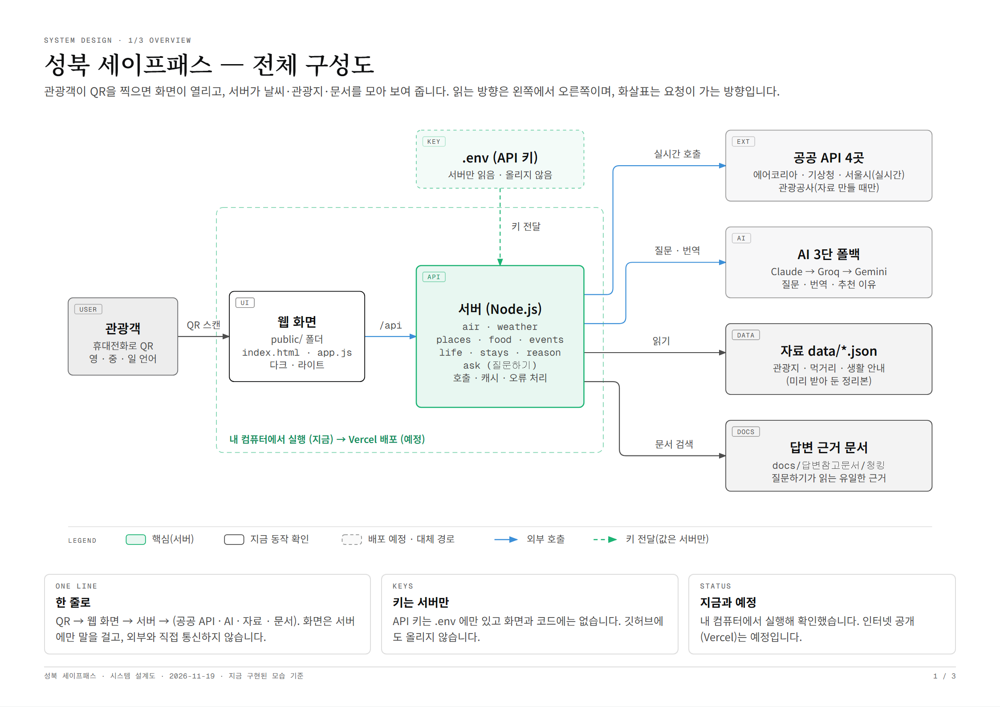
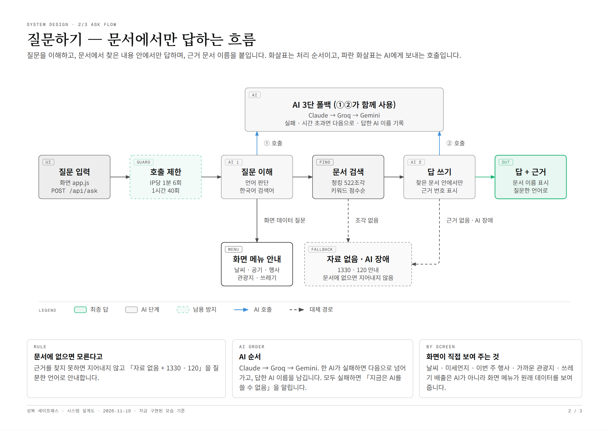
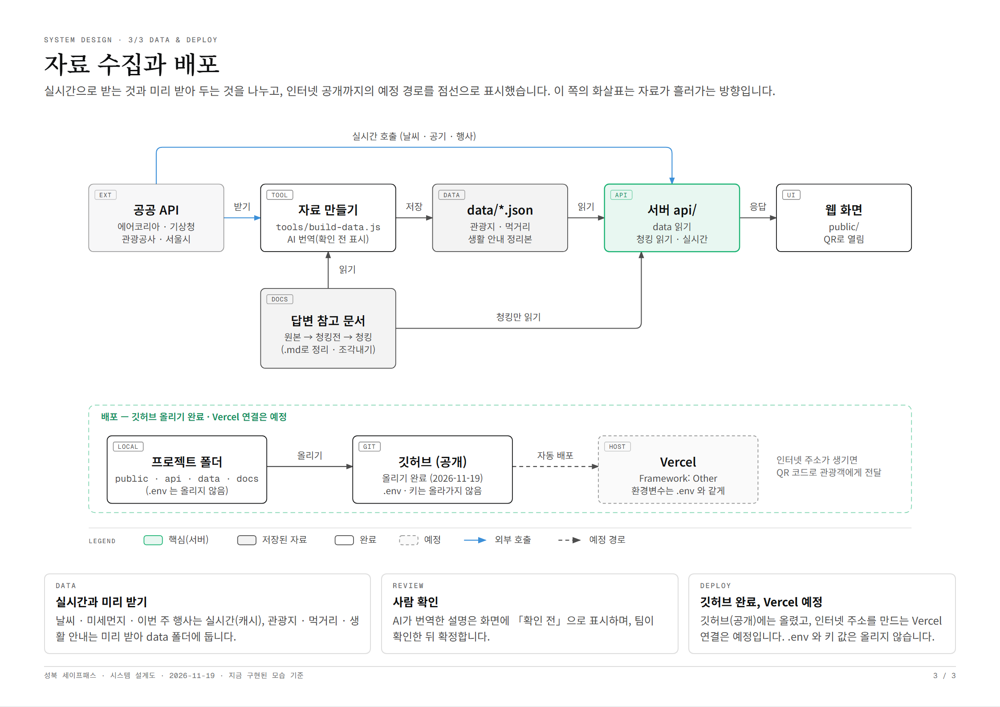

# 성북 세이프패스 (Seongbuk SafePass)

성북구 숙소에 머무는 **단기 외국인 관광객**이 **QR 코드 하나**로 오늘의 미세먼지·비 예보, 가까운 관광지·먹거리, 이번 주 행사, 생활 안내(쓰레기 배출·주민센터·경찰·와이파이·화장실)를 **영어 · 中文 · 日本語**로 보는 웹페이지입니다. 앱 설치가 필요 없고, 이름·연락처·위치를 받지 않습니다.

## 무엇을 보여 주나요

| 메뉴 | 내용 |
|---|---|
| 오늘의 안전 알림 | 미세먼지(에어코리아)와 비 예보(기상청). 마스크·우산 안내는 AI가 아니라 미리 정한 고정 문장입니다. |
| 가까운 관광지 | 숙소에서 가까운 순. 비가 오거나 공기가 나쁘면 실내 관광지를 먼저 보여 줍니다. 지도 열기·주소 복사 버튼이 있습니다. |
| 먹거리 | 백년가게·서울 오래가게 |
| 이번 주 행사 | 서울시 문화행사 중 성북구 행사(이름·날짜·장소는 원래 데이터 그대로) |
| 생활 안내 | 숙소 구역의 쓰레기 배출 요일·시간, 가까운 주민센터·경찰, 공공 와이파이, 공중화장실 |
| 질문하기 | 저장된 문서(`docs/답변참고문서/청킹`)에서만 답하고 근거 문서 이름을 붙입니다. 문서에 없으면 「자료 없음 + 1330 · 120」을 안내합니다. |

AI는 **Claude → Groq → Gemini** 순서로 부르고, 앞이 실패하면 다음으로 넘어갑니다.

## 시스템 설계도

전체 PDF: [docs/시스템설계도.pdf](docs/시스템설계도.pdf) (A4 가로 3쪽)

**1. 전체 구성도** — 관광객(QR) → 웹 화면 → 서버 → 공공 API · AI · 자료 · 문서



**2. 질문하기 흐름** — 문서에서만 답하는 과정



**3. 자료 수집과 배포**



## 폴더

| 폴더 | 역할 |
|---|---|
| `public/` | 이용자가 보는 화면 (`index.html`, `app.js`, `app.css`) |
| `api/` | 서버 코드. 공공 API와 AI 호출, 질문하기 (`_lib/` 은 공통 도구) |
| `data/` | 미리 받아 정리한 자료(관광지·먹거리·생활 안내 등) |
| `docs/답변참고문서/` | 질문하기의 근거 문서 (`원본/` → `청킹전/` → `청킹/`). 서버는 `청킹/` 만 읽습니다. |
| `tools/` | 자료 받기·만들기 도구 |
| `docs/` | 시스템 설계도, 배포 가이드 등 |

## 실행하기

Node.js 20.6 이상이 필요합니다. API 키가 든 `.env` 파일은 **저장소에 올라가 있지 않으므로** 팀에서 받아 프로젝트 폴더에 둡니다.

```bash
node --env-file=.env server.js
```

브라우저에서 `http://localhost:3000/?stay=A&lang=en` 을 엽니다.

- `stay=A` / `stay=B` : 시연용 가상 숙소 2곳 (QR 주소에 숙소가 들어갑니다)
- `lang=en` / `zh` / `ja` : 화면 언어
- `&demo=1` : 시연 버튼(날씨 바꾸기·QR 바꾸기)을 보여 줍니다. 관광객 화면에는 나오지 않습니다.

`.env` 에 넣는 키 이름: `CLAUDE_API_KEY`, `GROQ_API_KEY`, `GEMINI_API_KEY`, `DATA_GO_KR_KEY`(공공데이터포털), `seoulOpenDataKey`(서울 열린데이터광장). 키 값은 코드와 화면에 적지 않습니다.

자료를 새로 받으려면 다음을 실행합니다.

```bash
node --env-file=.env tools/build-data.js
```

## 지금 상태와 알려진 한계

- 내 컴퓨터에서 실행해 확인했습니다. 깃허브에는 올렸고, 인터넷 주소를 만드는 **Vercel 연결은 아직 하지 않았습니다.** 절차는 `docs/배포가이드.md` 에 있습니다.
- 관광지 설명의 **AI 번역은 사람 확인 전**이며 화면에 「확인 전」으로 표시됩니다.
- 실시간 날씨·미세먼지를 받지 못하면 숫자를 지어 보여 주지 않고 「불러오지 못했습니다」라고 알립니다.
- 가까운 **경찰서 거리순**과 **지하철·버스 이용법** 안내는 아직 없습니다. 실내·실외 구분은 팀이 정한 것이며 확인이 필요합니다.
- 운영 시간·요금은 바뀔 수 있습니다. 가기 전에 각 기관에 확인하도록 안내합니다.

## 데이터 출처

에어코리아, 기상청, 한국관광공사, 서울 열린데이터광장, 성북구청, 공공데이터포털.
